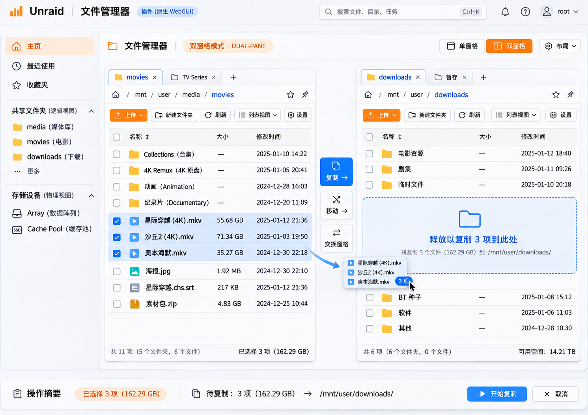
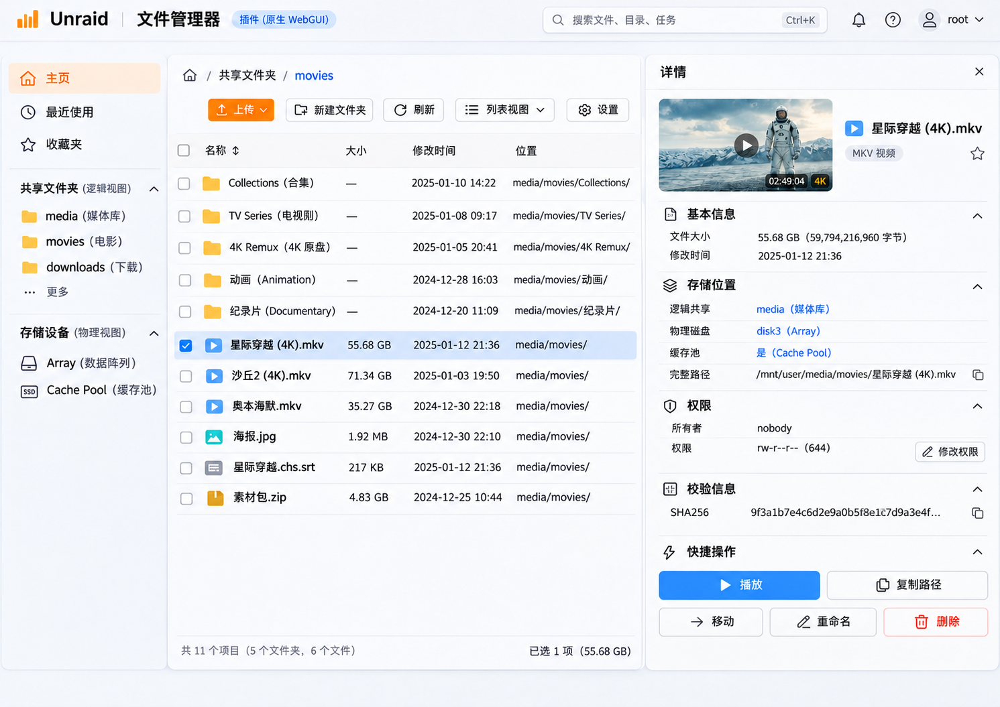
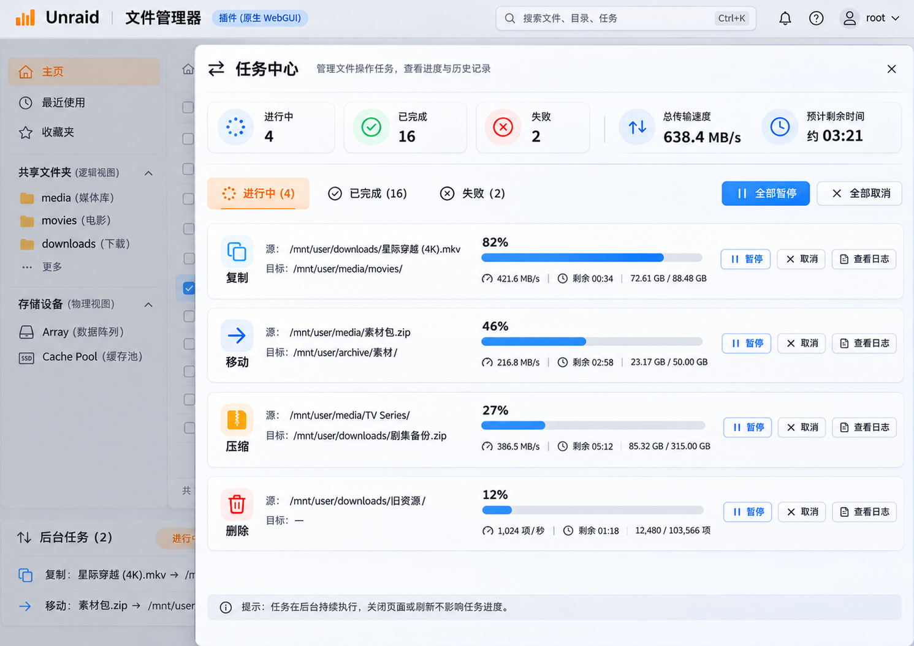
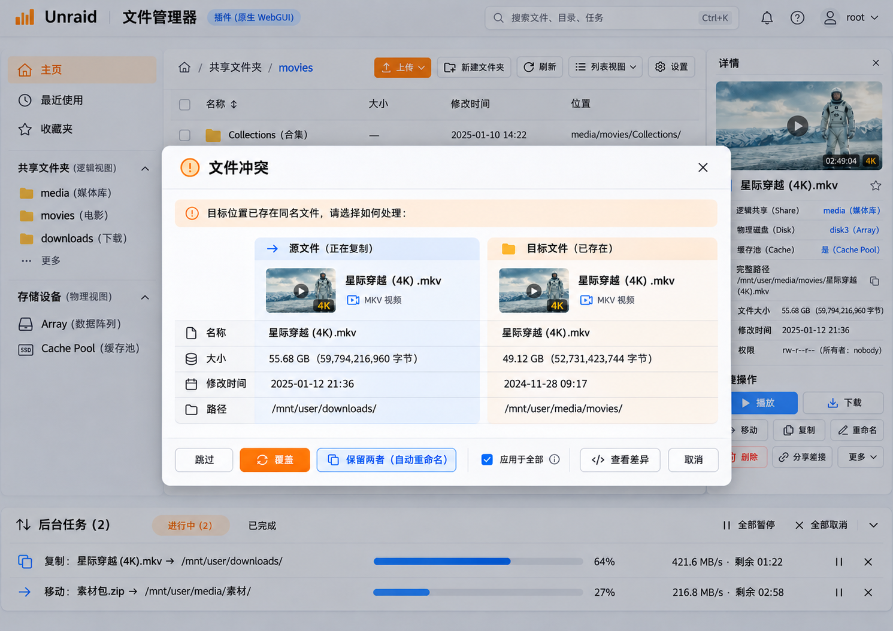

# Product & Technical Specification

> Source of truth for the Trove design (V1.1, 2026-11-23). The Chinese
> original was produced with Codex; this file is its markdown export.
> The six UI mockups live in `spec-assets/` and are design intent, not
> acceptance evidence — real-machine screenshots replace them during
> acceptance (see release-checklist.md).

---

**UNRAID / NATIVE PLUGIN**

**原生文件管理器插件**

产品需求与技术设计规格书

版本 V1.1（交互图增强版） · 2026-11-23 · 设计基线 / 兼容性待实机验证

**交付给开发 Agent 的执行基线**

原生 .plg 插件 · Unraid WebGUI 集成 · 存储安全感知文件操作 ·
后台任务与故障恢复

  ------------------------------------------------------------------------
  **文档版本**   V1.0
  -------------- ---------------------------------------------------------
  **编制日期**   2026 年 11 月 23 日

  **目标基线**   Unraid 7.4.x（以实机兼容验证为准）

  **文档状态**   设计基线 / 待 Sprint 0 安全 Spike
  ------------------------------------------------------------------------

**设计底线：文件不会因为插件设计缺陷而丢失。**

本文件面向自动化开发
Agent、技术审查人员及后续维护者；所有实机相关声明必须附测试证据。

# 目录与阅读路径

建议 Agent 先阅读第 0、4、6、8、10、11、14、15 章。UI
与用户体验相关工作重点阅读第 2、3 章。

> 0\. 给开发 Agent 的执行摘要
>
> 1\. 背景、定位与设计原则
>
> 2\. 范围与优先级
>
> 3\. 信息架构与页面交互
>
> 4\. 文件操作语义：最重要的安全规约
>
> 5\. 后台任务引擎
>
> 6\. 技术架构（推荐）
>
> 7\. HTTP API 草案（概念契约，不是已验证的 Unraid API）
>
> 8\. 安全模型与威胁清单
>
> 9\. 性能、稳定性与质量目标
>
> 10\. 实机测试矩阵：不得跳过
>
> 11\. 迭代计划与阶段验收
>
> 12\. 开发任务清单（建议转成 GitHub Issues）
>
> 13\. 仓库结构建议
>
> 14\. Agent 工作规约（直接执行）
>
> 15\. 待验证决策清单（不能擅自当作事实）
>
> 16\. 参考资料（公开链接，按核实程度分类）
>
> 附录 A：给实现 Agent 的开工指令（可直接复制）

附录 C：六张 UI 交互示意图（正式产品设计参考）

附录 D：交互行为、异常状态与验收规则（实现 Agent 必读）

> 附录 B：最重要的五条红线

# 0. 给开发 Agent 的执行摘要

**一句话目标**：打造一款简单、快速、可靠的 Unraid
原生文件管理器：普通用户像用 Finder 一样轻松，高级用户能像用 Total
Commander 一样高效，所有危险文件操作都由理解 Unraid
存储语义的后端进行安全决策。

**路线不可变更**：

> **1.** 使用 Unraid 官方支持的**插件安装/管理机制**（.plg）接入原生
> WebGUI；"官方插件机制"不意味着该产品获得 Unraid
> 官方背书，也不意味着有权限修改核心代码。
>
> **2.** 不替换、不覆盖、不 monkey-patch Unraid 自带 File
> Manager；提供独立入口，可从 Tools
> 菜单进入，设置页随插件集成；对原生任务托盘的集成仅在公开、稳定接口核实后进行。
>
> **3.
> 安全优先于功能完整度**：凡路径归属、挂载状态、源目标别名、操作可恢复性不明确，必须拒绝或降级为只读。不得先做通用
> cp/mv/rm 包装再补安全。
>
> **4.**
> 前端必须轻量、可访问、可用键盘完整操作；后台任务必须不受浏览器关闭影响。
>
> **5. 第一阶段先做兼容性验证和安全原型**，通过后再实现 UI
> 与功能。不要求一次性实现 V2。

## Agent 完成的定义

交付可安装的
.plg、可复现构建脚本、测试报告、安装/升级/卸载文档、实机或测试 Unraid
服务器上的录屏/截图和安全测试结果。若没有真实 Unraid
环境，必须标为"未经实机验收"，不得宣称产品已完成或可用于真实数据。

# 1. 背景、定位与设计原则

## 1.1 事实与设计假设

> **•** Unraid 有内置 File Manager。Unraid
> 7.4.0（2026-11-10）新增共享任务托盘、Mover 进度，修复了内置 File
> Manager 跨 Share / Pool 操作中的问题。
>
> **•** Unraid 7.2 及以后内置 GraphQL API。**不能假设 GraphQL
> 已提供所有文件系统写操作**；Agent 应检查实际 schema
> 和授权机制后再决定可复用的接口。
>
> **•** Unraid 的 /mnt/user 是聚合逻辑视图；/mnt/diskN 和 /mnt/\<pool\>
> 可能是同一数据的物理视图。官方文档明确反对在单次复制/移动中混合 User
> Share 与 Disk Share 路径。
>
> **•** .plg、.page、WebGUI 目录结构及 CSRF
> 实践可参考现有插件与社区维护文档，但每个接口必须在目标 Unraid
> 版本验证。

## 1.2 产品原则

> **• 默认简单，高级渐进披露**：初次进入不看到路径术语、Shell
> 命令和复杂配置。
>
> **• 原生融入，而非覆盖系统**：遵循 WebGUI
> 色彩模式、菜单、字体尺度、消息和任务表达；避免污染其他页面样式。
>
> **•
> 任务不丢、数据不丢、报错可理解**：对所有写操作提供明确的状态和可追踪结果。
>
> **• 存储机制可见但不强迫用户理解**：普通用户看到 Share；专家模式才看到
> Array、Disk、Pool 和文件实际所在位置。
>
> **• 只做文件管理本业**：不在 V1 做媒体库、智能相册、AI
> 整理、跨云同步、下载器。

## 1.3 目标用户

  ---------------------------------------------------------------------------------------
  **用户**                **主要任务**                     **关键诉求**
  ----------------------- -------------------------------- ------------------------------
  家庭 NAS 用户           整理下载、照片、视频、资料       看得懂、不会误删、能拖拽

  Unraid 资深用户         大文件迁移、批量改名、跨 Share   双栏、队列、性能、可审计
                          整理                             

  管理员/维护者           查看路径、权限、占用、异常文件   存储感知、只读诊断、安全保护
  ---------------------------------------------------------------------------------------

# 2. 范围与优先级

## 2.1 V1.0 / P0 必须完成

  ---------------------------------------------------------------------------------------------------------------------------------
  **编号**          **能力**          **用户可见结果**                         **交付门槛**
  ----------------- ----------------- ---------------------------------------- ----------------------------------------------------
  F-01              原生插件安装      Plugins 安装/卸载/升级，Tools 入口       不污染内置 File Manager；重启后可恢复

  F-02              文件浏览          Share 导航、面包屑、列表、排序、分页     十万条目录不冻结浏览器

  F-03              基础操作          新建目录、重命名、复制、移动、删除       写操作全部经预检和授权

  F-04              双栏模式          单栏/双栏切换，各栏独立路径与历史        键盘、菜单和拖拽均可用

  F-05              后台任务          任务进度、取消、日志、失败处理           关页面后仍可查询与继续；暂停仅支持可安全暂停的任务

  F-06              路径安全          区分逻辑 Share 与物理磁盘模式            禁止混用和别名覆盖，防路径逃逸

  F-07              基础搜索          当前目录/当前 Share 文件名筛选           大目录可中止、分页

  F-08              基础设置          默认视图、双栏、显示隐藏文件、任务并发   设置重启保持，敏感项安全默认关闭

  F-09              安全与质量        CSRF、会话授权、日志、测试               阻断高风险路径和不可信输入
  ---------------------------------------------------------------------------------------------------------------------------------

## 2.2 V1.5 / P1

文件预览（安全图片/视频元信息/文本/PDF）、下载/上传、批量重命名预演、压缩解压、SHA-256
校验、可选只读文件所在磁盘显示、持久搜索索引、收藏夹、可配置回收站（须先完成安全设计）、基本权限查看。

## 2.3 V2 / P2

远程 SMB/NFS/SFTP 浏览、操作历史筛选、可选自动化
API/CLI、批量规则、存储分布可视化、目录空间分析；任何存储位置**强制重分布**必须单独经过安全评审和真实机器验证。

## 2.4 不在本产品范围

不替代 Unraid Shares/Disks/Pool 设置、不修改 Mover 内核逻辑、不实现
Parity 校验、不承诺 RAID/Parity 是备份、不修改 Docker/VM
文件使用策略、不绕过系统用户授权；不开放任意 Shell 执行能力。

# 3. 信息架构与页面交互

## 3.1 信息架构

> Unraid WebGUI\
> └── Tools\
> └── Native Files\
> ├── Files（默认文件视图）\
> │ ├── 左侧导航：Home / Recent / Favorites / Shares\
> │ ├── 中央文件区：列表或网格 / 单栏或双栏\
> │ ├── 右侧 Inspector（按需显示）\
> │ └── 底部 Tasks 抽屉\
> └── Settings（插件设置）

**入口策略**：以 Tools → Native Files 为首选。通过 .page
原生注册、单页嵌入 SPA（静态
JS/CSS）实现；不创建额外的对外监听端口。不得未经用户选择替换系统 Files
导航。

## 3.2 布局与视觉规则

> **•** 桌面端：左导航 210--250 px；文件区自适应；Inspector 300--360
> px，可关闭；任务抽屉收起时为小条。
>
> **•** 1280 px 以下：可自动收起
> Inspector。小屏幕：侧栏抽屉化，不强行双栏。
>
> **•**
> 默认列表模式；文件名、大小、修改日期、类型，按需显示所在设备。支持列宽调整、键盘排序、图标/网格切换。
>
> **•** 全部图标采用统一线性视觉风格。浅色与深色自动匹配 Unraid
> 主题，优先沿用原生 CSS 变量，不向全局注入冲突样式。
>
> **•** 数据很多时使用虚拟列表；缩略图懒加载；默认不做全盘递归扫描。
>
> **•**
> 加载、空目录、无权限、磁盘休眠、阵列停止、脱机、部分失败均有独立状态。

## 3.3 核心交互

> **•** 单击选择；双击打开；Ctrl/Cmd 多选、Shift
> 范围选择、右键上下文菜单、空白处右键。
>
> **•** 顶部面包屑支持定位；Alt+Left/Right 历史前进后退；Backspace
> 上一级（浏览器兼容性需验证）。
>
> **•** Ctrl/Cmd+C、V、X、A、F；F2 重命名、Delete 删除；Ctrl+K
> 打开命令面板。与浏览器保留快捷键冲突时优先遵守平台规范。
>
> **•**
> 双栏是**模式**不是默认强制布局。左右栏可拖动文件、独立地址和排序，目标路径永远可见。跨栏移动需要明确"复制/移动"动作，禁止无提示跨文件系统隐式删除。
>
> **•**
> 批量操作先显示文件数量、总大小估计、目标路径、冲突策略、风险等级和可否撤销。
>
> **•**
> 文件详情展示：路径、大小、类型、mtime、owner/group、读写状态；物理位置仅在可验证时显示，不能可靠确认就显示"未知"。

## 3.4 交互文案

使用用户可理解的描述，而不是裸 errno：

> **•** 存储阵列已停止，此路径暂时不可访问（只读/写操作均提示）。
>
> **•** 此操作可能使源路径与目标路径指向同一份数据，已为保护文件而阻止。
>
> **•** 目标磁盘可用空间不足，已停止写入；原文件保持不变。
>
> **•** 文件在复制期间被其他程序修改。新副本已保留供检查，源文件未删除。
>
> **•** 不能安全恢复的操作不会显示"撤销"按钮。

# 4. 文件操作语义：最重要的安全规约

## 4.1 按命名空间建模，不以字符串路径做决策

操作引擎必须认识至少以下根类型：

> ShareRoot(share_id) -\> /mnt/user/\<share\> \[逻辑视图\]\
> DiskRoot(disk_id) -\> /mnt/diskN \[物理视图，专家模式\]\
> PoolRoot(pool_id) -\> /mnt/\<pool\> \[物理视图，专家模式\]\
> ExternalRoot(mount_id) -\> 未来扩展，不在 V1 写操作范围\
> ProtectedSystemRoot -\> /boot、/etc、/usr、/proc、/sys 等，永久拒绝

每次操作以**类型化资源 ID +
根内相对路径**为输入。前端不能传入任意绝对路径让后端执行。所有路径解析需验证允许根、挂载点、设备标识、符号链接、根内约束及
symlink race（TOCTOU）。优先采用 descriptor-relative 文件 API；如使用
Linux openat2 约束，必须有明确、同样安全的兼容回退或拒绝操作。

## 4.2 V1 安全操作矩阵

  -------------------------------------------------------------------------------------------------------------------
  **来源 → 目标**      **复制**             **移动**             **策略**
  -------------------- -------------------- -------------------- ----------------------------------------------------
  同一 Share → 同一    允许                 允许                 检查同一文件、目录嵌套和覆盖冲突；不承诺改变物理盘
  Share                                                          

  Share A → Share B    允许                 条件允许             按逻辑视图处理，跨 Share 移动须确认实际结果，不能凭
                                                                 rename() 推断已按目的 Share 策略迁移

  Disk A → Disk B      专家模式按验证结果   专家模式按验证结果   仅在纯物理模式，保守策略，默认禁写直至测试通过

  Pool A → Pool B      专家模式按验证结果   专家模式按验证结果   必须独立挂载有效；默认禁写直至测试通过

  任意 Share ↔ 任意    **拒绝**             **拒绝**             禁止混用命名空间，含间接别名/软链/挂载绕行
  Disk/Pool                                                      

  系统目录或未知挂载 → **拒绝**             **拒绝**             不开放任意 root 文件管理
  任意目标                                                       
  -------------------------------------------------------------------------------------------------------------------

**特别说明**：官方文档明确指出 /mnt/user 与 /mnt/diskN
可能是同一数据的不同视图；V1
一律禁止两类视图相互复制/移动，宁可限制能力也不冒数据损坏风险。对于跨
Share/Pool
物理放置，**"路径改变"并不等于"文件已迁移到目标介质"**。必须定义用户意图、验证实际放置，否则不给"已转移到某磁盘"的承诺。

## 4.3 复制与移动的安全协议

> REQUEST\
> → AUTHORIZED（认证、权限、CSRF、请求限流）\
> → PLAN（解析资源、判定命名空间、检测别名/递归/冲突）\
> → PREFLIGHT（阵列/挂载/可写/空间/文件稳定性）\
> → APPROVED（高风险操作需要明确确认）\
> → QUEUED\
> → COPYING_TO_STAGING（目标文件系统内临时文件）\
> → VERIFYING（至少大小/元数据；可选 SHA-256）\
> → COMMITTING（同文件系统内原子提交，按冲突策略）\
> → SOURCE_DELETE（仅移动、验证完成且源快照未变化时）\
> → SUCCEEDED

失败分支：FAILED_RETRYABLE / FAILED_FINAL / CANCELLED /
NEEDS_ATTENTION，不能把"部分复制"伪装为成功。目录操作需有 manifest
记录子文件状态，不能宣称整目录原子性。发生宕机、断电或卸载时，必须保留可解释的中间状态，恢复后重新验证。

**强制原则**：

> **1.**
> 覆盖目标前有明确冲突策略：跳过、重命名、经确认覆盖；不得静默覆盖。
>
> **2.** 源与目标同文件（含通过物理/逻辑视图间接指向）必拒绝。
>
> **3.**
> 目标写入失败不删除源；移动需复制成功、验证完成、确认源未变化后才删除源。
>
> **4.**
> 操作前再次检查挂载点与资源身份，避免拔盘、重挂载、重新分配设备后写到错误位置。
>
> **5.**
> 多个任务竞争同一目标/源目录必须采用清晰锁与冲突序列化策略；避免与自己并发覆盖。
>
> **6.**
> 硬链接、软链接、稀疏文件、权限、mtime、ACL、xattr、文件系统特殊文件要有显式支持矩阵。未支持的类型拒绝，不进行隐式解引用或转普通文件。
>
> **7.** 不信任客户端提供的 size、hash、path、job status 等字段。
>
> **8.** fsync 和 rename
> 可提升单文件提交的可靠性，但不能保证任意文件系统/跨盘目录操作的全局原子性。
>
> **9.** 不允许通过前端参数拼接 Shell
> 命令。若确有调用原生工具的必要，必须使用固定
> executable、参数数组及安全检查，禁止命令解释器。
>
> **10.** 对正在被 Docker/VM/Mover 使用的文件不能凭"没有锁"判断安全；对
> appdata、domains、system 等共享写操作提高保护等级或默认只读。

## 4.4 删除与回收站

V1：支持经过确认的删除；默认不承诺系统级回收站与撤销。敏感目录和批量删除需二次确认，明确计数/位置。递归删除需要专门审计。V1.5
可选回收站，但必须明确同一文件系统
rename、容量回收策略、恢复路径冲突、不同池上的隔离、卸载后保留数据等语义；若无法安全实现，继续不提供回收站。

## 4.5 权限和元数据

> **•** 默认保留合理的 POSIX 权限和时间戳；不得擅自递归 chown -R。
>
> **•** 从 Windows 上传文件时，文件名字符处理与 UTF-8
> 正规化要测试；Linux 大小写敏感特性不可隐去。
>
> **•** 符号链接默认显示为链接本身；预览和编辑不追踪到允许根之外。
>
> **•** 物理落盘位置受 FUSE/Share
> 策略影响，位置显示必须标明"检测时快照"，并避免扫描唤醒所有盘。

# 5. 后台任务引擎

## 5.1 V1 任务能力

任务在服务端排队和执行，至少支持：查询、进度、取消、日志、失败重试、页面关闭后继续。复制类任务可以安全暂停/恢复时才显示此按钮；rename
等瞬时动作无"暂停"概念。任何中断恢复都必须使用校验和已提交状态判断，不能简单从旧偏移盲目续写。

## 5.2 任务状态模型

PLANNED → QUEUED → RUNNING → VERIFYING → COMPLETED，以及
PAUSING/PAUSED/RESUMING（可选）、CANCELLING/CANCELLED、FAILED_RETRYABLE/FAILED_FINAL、NEEDS_ATTENTION。

最少记录：job_id、request_id（幂等键）、owner/session、时间戳、动作类型、规范化源目标资源、策略、总文件数、已完成数、已处理
bytes、当前文件、错误码、可重试标记、操作摘要、事件日志、恢复检查点。

## 5.3 可靠性和系统节制

> **•** 任务状态**持久化到非 USB 闪存的已配置数据目录**，例如专用
> Pool/Share 下插件数据目录；不在 /boot 高频写 SQLite/WAL/进度日志。
>
> **•** /boot/config/plugins/\<plugin\>/
> 只保存小型配置及发行包等低频数据。
>
> **•**
> 持久存储不存在或尚未挂载时：只读可用；新的危险写任务禁止提交，明确提示用户。
>
> **•** 限制默认并发：**默认同时执行 1
> 个大文件写任务**，其余排队；高级设置可调整并发。
>
> **•** 严格控制内存占用、磁盘
> I/O、目录扫描并发及缩略图生成；不为了搜索/预览主动唤醒全部休眠磁盘。
>
> **•** 对 Array Stopping、Pool
> 卸载、低空间、磁盘错误要停止或挂起任务，不重试到未知路径。
>
> **•** 7.4
> 的共享任务托盘：先检查是否存在可供第三方插件使用的稳定扩展接口；可用则适配；不可用则使用插件自己的抽屉，**不可逆向修改核心
> WebGUI 脚本来注入**。

# 6. 技术架构（推荐）

> ┌──────────────────────────────────────────────────────┐\
> │ Unraid WebGUI（同源） │\
> │ Native Files .page + 静态前端 bundle │\
> │ - Browser / Dual Pane / Search / Inspector / Tasks │\
> └───────────────────────┬──────────────────────────────┘\
> │ 同源 API + Unraid 登录态 / CSRF\
> ▼\
> ┌──────────────────────────────────────────────────────┐\
> │ WebGUI Gateway（PHP 轻量适配层，依版本核实） │\
> │ - 认证、会话、CSRF、限流、输入校验、授权审核 │\
> │ - 仅允许白名单 endpoint；不执行大文件复制 │\
> └───────────────────────┬──────────────────────────────┘\
> │ Unix domain socket（本机、权限受限）\
> ▼\
> ┌──────────────────────────────────────────────────────┐\
> │ Files Core / Job Daemon │\
> │ Root Registry → Path Resolver → Operation Planner │\
> │ → Conflict Resolver → Safe Executor │\
> │ Job Queue / Journal / Audit / System State Adapter │\
> └───────────────────────┬──────────────────────────────┘\
> ▼\
> Unraid Shares / Array / Pools

## 6.1 技术选型建议

  ---------------------------------------------------------------------------------------------------------
  **层**                  **推荐方案**                      **理由与约束**
  ----------------------- --------------------------------- -----------------------------------------------
  WebGUI 接入             .plg + .page + 小型 PHP Gateway   遵循现有插件机制；不改系统内置页面

  前端                    TypeScript + Preact/轻量 UI +     交互复杂但尽可能降低体积；bundle 必须无外部 CDN
                          Vite 静态打包                     依赖

  后台                    Go 或 Rust 编译的轻量守护进程     原生 Linux 文件
                                                            API、后台任务、易于独立测试；不得新增公开端口

  存储状态                SQLite（专用数据目录）+           任务可恢复；控制写放大和数据迁移
                          JSON/结构化事件日志               

  Unraid 系统状态         优先已文档化                      版本敏感字段经测试并隔离在 Adapter
                          API；必要时只读适配系统状态文件   

  打包                    .plg manifest + 版本化            生命周期可控，便于离线复现与更新
                          .txz/资源包 + SHA-256             
  ---------------------------------------------------------------------------------------------------------

**Racket 技术偏好评估**：允许 Agent 做 1--2 天技术 Spike，评估 Racket
运行时部署体积、Linux 文件 API、Unraid
重启/插件打包、进程管理与安全维护成本。如果需要额外庞大运行时或无法有效防范路径竞态，则不强行使用；这里优先可靠性和可发布性。无论语言如何，**核心文件操作库必须独立于
UI**。

## 6.2 核心模块边界

> **•** unraid-adapter：只获取 Share、Disk、Pool、Array、Mover
> 状态；不把业务决策写进 PHP UI。
>
> **•** root-registry：将允许的存储根建模为不可伪造的资源标识，绑定
> mount 身份和权限。
>
> **•** path-resolver：路径规范化、别名判断、root
> 下解析、链接策略、TOCTOU 防护。
>
> **•**
> operation-planner：纯逻辑、可单测；输入资源与意图，输出允许/拒绝、成本估计、风险级别、迁移策略。
>
> **•** executor：复制、移动、删除、重命名的受控实际执行者。
>
> **•**
> job-service：任务状态、幂等、调度、恢复、取消、事件流、审计日志。
>
> **•** gateway：同源 Web 请求与后台 daemon 的唯一桥梁。
>
> **•** ui：浏览器适配层；**不持有文件系统绝对路径执行权限**。

## 6.3 数据目录与安装生命周期

> /boot/config/plugins/native.files/ \# 小型持久配置/包缓存，低写入\
> /usr/local/emhttp/plugins/native.files/ \# WebGUI .page、PHP、静态
> bundle（重启重建）\
> /usr/local/sbin/native-filesd \# 后台执行程序（示意路径，需实机验证）\
> /run/native-files/ \# Unix socket / PID（临时）\
> \<选定持久数据目录\>/native-files/ \# Jobs SQLite / manifest /
> audit（不放 USB）

安装、更新、卸载必须幂等；升级需校验哈希、保留用户设置/任务状态，支持迁移/回退；卸载默认保留用户数据并明确告知如何删除。启动顺序必须对"阵列未挂载、持久数据路径还不可用"作防护，不得把目录写到未挂载的空挂载点上。

# 7. HTTP API 草案（概念契约，不是已验证的 Unraid API）

同源命名空间示例 /plugins/native.files/api/v1。最终路由要依据 Unraid 7.4
当前 WebGUI 路由及权限验证。所有请求须继承 WebGUI
身份、CSRF/同源约束；后台 Unix socket 不对远程开放。

  --------------------------------------------------------------------------------------------------------------------------------
  **Method**              **Path**                                     **用途**
  ----------------------- -------------------------------------------- -----------------------------------------------------------
  GET                     /capabilities                                返回支持版本、模式、功能开关、当前只读原因

  GET                     /roots                                       枚举可访问的 Share/Pool/Disk 资源

  GET                     /entries?rootId=\...&path=\...&cursor=\...   目录分页浏览（相对路径是展示/导航参数，不是任意绝对路径）

  GET                     /entry?rootId=\...&path=\...                 元数据、只读可用性

  POST                    /operations/plan                             干运行：判断安全、冲突、估算/确认需求

  POST                    /jobs                                        以确认 token + 幂等 key 提交操作

  GET                     /jobs?cursor=\...                            列表任务

  GET                     /jobs/{id}                                   任务详情

  POST                    /jobs/{id}/cancel                            请求安全取消

  POST                    /jobs/{id}/retry                             经重新预检后重试

  GET                     /jobs/{id}/events                            受限事件拉取或 SSE（经网关授权）

  GET / PUT               /settings                                    获取/修改插件配置
  --------------------------------------------------------------------------------------------------------------------------------

请求示例（仅用于表达设计，字段需 API 契约与 schema 测试固化）：

> {\
> \"action\": \"copy\",\
> \"source\": {\"rootId\": \"share:media\", \"relativePath\":
> \"movies/demo.mkv\"},\
> \"target\": {\"rootId\": \"share:archive\", \"relativePath\":
> \"movies/demo.mkv\"},\
> \"conflictPolicy\": \"rename\",\
> \"verify\": \"size-and-metadata\",\
> \"clientRequestId\": \"8c21f2a1-\...\"\
> }

**必须先 plan 后 commit**，plan
返回服务端生成、短期有效、绑定源/目标状态与身份的 confirmation
token；若资源、文件
mtime/大小、挂载标识或授权发生变化，提交时拒绝并要求重新计划。不得把客户端显示的风险级别当作授权依据。

## 7.1 错误格式

> {\
> \"error\": {\
> \"code\": \"NAMESPACE_MIX_FORBIDDEN\",\
> \"message\": \"不能在逻辑共享与物理磁盘视图之间执行此操作\",\
> \"recoverable\": false,\
> \"requestId\": \"\...\"\
> }\
> }

建议错误码：UNAUTHORIZED、CSRF_INVALID、ROOT_NOT_ALLOWED、PATH_ESCAPE、NAMESPACE_MIX_FORBIDDEN、SAME_FILE_ALIAS、ARRAY_STOPPED、MOUNT_CHANGED、INSUFFICIENT_SPACE、SOURCE_CHANGED、CONFLICT_REQUIRES_DECISION、IO_FAILURE、JOB_STORAGE_UNAVAILABLE。

# 8. 安全模型与威胁清单

## 8.1 威胁模型

对手可控制文件名、目录名、路径参数、浏览器中的 JS 请求（包括恶意页面触发
CSRF）、部分 SMB 文件内容、符号链接、并发操作时机；但不假设其已有 root
Shell 权限。

## 8.2 P0 安全要求

> **•** 服务端严格认证、授权、CSRF、Origin/Host 校验（符合现行 Unraid
> WebGUI 实现）；**不得仅靠前端隐藏按钮**。
>
> **•** 若现有 WebGUI 认证集成无法可靠核实，停止写操作并提交设计阻塞
> Issue。
>
> **•** 禁止 SSRF、路径穿越 (..、绝对路径、编码变体)、symlink /
> bind-mount 越界、Zip Slip（待 P1）、任意文件读写、命令注入和前端 XSS。
>
> **•** 危险文件名只能作为 text 显示，不能通过 innerHTML 插入；CSP
> 需兼容现行 WebGUI。
>
> **•** 文件预览永不在管理员同源上下文中执行不可信
> HTML/JS；原始文件下载/预览设置合适 Content-Type、Content-Disposition
> 和 nosniff。
>
> **•** 守护进程不对 0.0.0.0 开 HTTP/TCP；本地 socket
> 权限最低化。若文件操作不得不使用
> root，必须隔离高权限执行代码并有白名单与审计。
>
> **•** 只可访问允许的文件根；/boot、系统目录、Docker socket、SSH
> 私钥、插件配置与任务数据库默认不在可操作范围。
>
> **•** 针对目标目录软链替换、原目录换挂载、文件并发变更做竞态测试。
>
> **•** 日志不记录 WebGUI
> 凭证和用户敏感文件内容；可记录经适度脱敏的路径、错误与操作摘要。
>
> **•** 安装包、更新包固定版本与 SHA-256 校验，避免使用不固定的 latest
> 运行时依赖。

# 9. 性能、稳定性与质量目标

以下是**产品验收目标**，不是当前已测性能承诺。必须在规定测试机器上写清环境后量化。

  -------------------------------------------------------------------------------------------
  **指标**                **目标**                                   **测量方法**
  ----------------------- ------------------------------------------ ------------------------
  UI 反馈                 本地正常网络下可见点击反馈 \< 150 ms       Playwright/Performance
                                                                     Trace

  10 万文件目录           可分页/虚拟滚动，不锁死主线程              真实 100k
                                                                     文件测试集，内存曲线

  任务恢复                浏览器关闭、刷新不影响服务器任务；daemon   故障注入，核对文件哈希
                          重启后可恢复或明确解释                     

  后台资源                空闲不主动扫描/唤醒全部磁盘                iostat / powertop /
                                                                     磁盘状态对比

  错误完整性              写操作失败后原文件不丢失，无误报成功       磁盘满、kill
                                                                     -9、卸载、错误注入

  构建                    clean checkout 可复现构建与测试            CI 无手工私有步骤

  可访问性                关键操作可键盘完成、焦点可见               axe + 人工测试
  -------------------------------------------------------------------------------------------

合理的响应时间预算是**UI
首先回应、重活异步执行**，不是要求机械盘即时返回列表。搜索和索引在无法维持磁盘休眠时默认关闭或只查现有缓存。

# 10. 实机测试矩阵：不得跳过

  -------------------------------------------------------------------------------------------------------
  **ID**                  **场景**                               **预期**
  ----------------------- -------------------------------------- ----------------------------------------
  T01                     .plg 安装、升级、卸载、重启            页面可恢复；配置保存；系统文件不被覆盖

  T02                     7.4.x WebGUI 深浅主题与浏览器缩放      可读，无样式泄露

  T03                     /mnt/user/share ↔ /mnt/diskN/share     后端明确阻止，源/目标哈希不变

  T04                     /mnt/user ↔ /mnt/\<pool\>              同样阻止，不接受软链绕过

  T05                     源与目标同一 inode/别名                阻止覆盖和移动

  T06                     ../、URL 编码路径、Unicode             正确拒绝或安全处理，不越根
                          文件名、超长路径                       

  T07                     运行中替换符号链接或挂载               拒绝/中止，不写到非授权根

  T08                     跨 Share 移动与目标 Share 策略不同     不误报物理放置；文件可完整校验

  T09                     单个 80GB 文件复制，10GB 后浏览器关闭  任务继续，进度可重新查看

  T10                     中途磁盘满                             源文件保留，任务失败说明明确

  T11                     daemon 复制期间 kill -9                恢复/清理策略正确，不误删源

  T12                     复制过程中源文件被其他进程修改         不删除变化中的源，任务进入待处理

  T13                     复制过程中 Array Stop 或 Pool 卸载     安全停下，不落入空目录/错误挂载

  T14                     目标已存在：跳过/自动重命名/确认覆盖   行为符合预演，绝不静默覆盖

  T15                     目录与自身子目录作为目标               阻止递归复制炸裂

  T16                     Docker/VM 使用中的                     默认保护或明确风险拦截
                          appdata/domains/system                 

  T17                     100k 项目录、快速滚动、多选、排序      UI 无明显冻结；分页正确

  T18                     无登录、CSRF 失效、跨站访问            所有写请求被拒绝

  T19                     恶意文件名：\       不触发 XSS

  T20                     插件数据目录不可用/USB 只读            只读退化，有明确信息，不写高频日志到 USB

  T21                     两个浏览器同时发起目标冲突任务         串行/冲突处理可解释，无数据相互覆盖

  T22                     ZFS/Btrfs/XFS 及 cache-only /          通过特性矩阵验证，不支持的模式明确禁写
                          exclusive share                        

  T23                     停止中的任务取消、重启后重试           状态一致，不重复删除/覆盖

  T24                     缩略图或搜索时 HDD 睡眠                不全盘唤醒；设置与行为一致
  -------------------------------------------------------------------------------------------------------

验收报告必须提供：系统版本、CPU/内存、Pool/Array
文件系统、测试数据结构、操作前后清单/哈希、日志、截图/视频、Pass/Fail
与未覆盖风险。

# 11. 迭代计划与阶段验收

## Sprint 0：可行性和安全 Spike（先完成，阻塞后续）

> **1.** 在真实 Unraid 7.4.x 测试机验证 .plg 安装、.page
> 入口、独立样式和 JS、WebGUI 会话/CSRF、PHP Gateway、安全本地 daemon
> 通信。
>
> **2.** 研究官方 GraphQL Schema 的实际文件/存储能力，确认能否复用；核实
> 7.4 共享任务托盘**是否有公开稳定扩展点**，无则放弃原生集成。
>
> **3.** 编写**不做文件操作**的 Root Registry + operation/plan 纯逻辑
> prototype，覆盖混用路径、同文件别名、symlink 越界、阵列状态。
>
> **4.** 提交
> docs/adr/：架构决策、授权方案、运行时选择、兼容范围、无法解决的风险。

**Gate
0**：安装/入口/认证/只读枚举/拒绝高危命名空间的测试通过，否则不得实现真正删除或移动。

## Sprint 1：稳定浏览器

完成原生导航、列表与分页、单栏/双栏、面包屑、排序、键盘、收藏（可延后）、设置、暗亮主题、加载/错误/空态、基本搜索。所有页面读操作必须严格限定根。

**Gate 1**：真实目录 100k
项测试通过、全部路径无法越根、未登录不能访问；关闭浏览器不产生后台扫描。

## Sprint 2：安全任务引擎

完成 plan → commit、同一 Share 的新建/改名/复制/移动/删除、跨 Share
复制、任务数据库、日志、取消/恢复/错误码、冲突对话框。跨 Share
移动只有在验证过语义后开放，否则先以复制/确认删除替代并明确告知。

**Gate 2**：T03--T16、T18--T21 测试必须通过；所有失败测试必须有明确
Issue，不能发布为稳定版。

## Sprint 3：插件发布

完成 .plg 和 package CI、安装与更新演练、README、CHANGELOG、Support
页面、诊断日志收集（脱敏）、安全审计、用户文档，以及 Community
Applications 提交流程准备。

**Gate
3**：从空白系统安装→使用→升级→卸载→重启完整链路通过；提交审查后再标为稳定发布。

## 后续阶段

V1.5 和 V2 仅按前述优先级推进，不得以扩展功能替代 P0 可靠性收尾。

# 12. 开发任务清单（建议转成 GitHub Issues）

## Epic A：原生插件基础

> **•** A1 .plg 构建、固定版本包、SHA-256 校验、install/update/remove
> hooks；
>
> **•** A2 WebGUI .page 与主题隔离；
>
> **•** A3 登录态/CSRF 网关与 Unix socket；
>
> **•** A4 系统能力检测（支持版本、Array、Share、Pool、数据路径）。

## Epic B：安全文件引擎

> **•** B1 Root Registry / 类型化资源 ID；
>
> **•** B2 Path Resolver/Path Alias/Race 防护；
>
> **•** B3 Operation Planner 与风险分级；
>
> **•** B4 复制/移动阶段性提交和冲突策略；
>
> **•** B5 删除、取消、故障恢复和日志；
>
> **•** B6 任务调度、持久化、并发隔离。

## Epic C：界面体验

> **•** C1 侧栏、列表、分页、面包屑；
>
> **•** C2 单栏/双栏及独立导航；
>
> **•** C3 选择、拖拽、快捷键、上下文菜单；
>
> **•** C4 预演弹窗、冲突处理；
>
> **•** C5 任务抽屉、错误详情、通知；
>
> **•** C6 主题、响应式、可访问性。

## Epic D：测试与发行

> **•** D1 单元/属性测试，路径与 planner 模糊测试；
>
> **•** D2 安全威胁模型与竞态故障注入；
>
> **•** D3 E2E（Playwright）和 Unraid 实机矩阵；
>
> **•** D4 CI、多版本发布物、安装/升级/卸载自动检查；
>
> **•** D5 README、架构决策、API 契约、运维说明、发布清单。

**通用 Definition of
Done**：代码合并前需有测试、文档、错误处理、回滚策略；所有 P0
改动不得引入未知根路径访问；CI
通过；开发者记录剩余风险和测试证据。不要以"代码已经写完"代替"功能已在
Unraid 上验收"。

# 13. 仓库结构建议

> native-files-unraid/\
> ├── README.md\
> ├── LICENSE\
> ├── AGENTS.md \# Agent 约束和开发流程\
> ├── docs/\
> │ ├── specification.md \# 本规格书\
> │ ├── architecture.md\
> │ ├── threat-model.md\
> │ ├── api-contract.md\
> │ ├── compatibility-matrix.md\
> │ ├── release-checklist.md\
> │ └── adr/\
> ├── plugin/\
> │ ├── native.files.plg\
> │ ├── native.files.page\
> │ ├── php/ \# 安全 Gateway\
> │ ├── hooks/ \# 生命周期脚本\
> │ └── packaging/\
> ├── frontend/\
> │ ├── src/\
> │ └── tests/\
> ├── core/\
> │ ├── cmd/\
> │ ├── internal/\
> │ │ ├── roots/\
> │ │ ├── resolver/\
> │ │ ├── planner/\
> │ │ ├── executor/\
> │ │ ├── jobs/\
> │ │ └── unraid/\
> │ └── tests/\
> ├── tests/\
> │ ├── fixtures/\
> │ ├── security/\
> │ ├── fault-injection/\
> │ └── e2e/\
> └── .github/workflows/

此结构用于分离职责，语言选型变化可调整 core/ 内部目录，但 API
与测试契约不能降低。

# 14. Agent 工作规约（直接执行）

> **1. 先读本规格书、Unraid 7.4.x Release Notes、Shares/Cache Pools
> 官方说明，以及现有 File Manager
> 能力**。写出"已存在能力/新开发能力/不可复用能力"清单。
>
> **2.** 先创建
> docs/architecture.md、docs/threat-model.md、docs/compatibility-matrix.md
> 和 ADR；存在关键安全未知时开阻塞 Issue，不用"以后再补"掩盖。
>
> **3.** 每个阶段实现后实际运行测试；优先清理 P0
> 缺陷再进下一阶段。**没有 Unraid 实机的测试证据不得声称安全发布**。
>
> **4.** 如果不能验证 WebGUI
> 授权、命名空间安全或持久任务存储，则相应写操作保持禁用。不得自行"绕过"。
>
> **5.** 不改 Unraid 核心文件，不修改官方数据库/接口内部协议，不以修改
> /usr/local/emhttp 原有文件作为功能依赖。
>
> **6.**
> 每一轮开发输出：实现内容、测试结果、关键截图、已知问题、下一步；必要时拆成可复现
> Issues/PRs。
>
> **7.**
> 尊重已有技术偏好，但工程可靠性优先；不要为了统一语言而牺牲插件兼容性。
>
> **8.** 如果需要替代原生系统功能，只能在有稳定
> API、明确用户选择与回滚手段的情况下引入适配层，不能静默替换。

# 15. 待验证决策清单（不能擅自当作事实）

  -------------------------------------------------------------------------------------------
  **决策**                **默认建议**               **必须提供的证据**
  ----------------------- -------------------------- ----------------------------------------
  WebGUI 路由和菜单注入   .page 注册 Tools           7.4.x 可用的最小真实插件

  会话/CSRF 网关          PHP 与原生机制集成         未登录、CSRF、Origin 测试通过

  共享任务托盘集成        先使用插件内任务抽屉       官方或可维护扩展点的证据

  后台语言                Go/Rust 首选，Racket 可    运行时包体、权限、测试、内存对比
                          Spike                      

  数据库路径              用户可配置、放专用         重启/Array 停止/挂载缺失恢复
                          Pool/Share                 

  物理盘模式写操作        V1 默认禁写                无别名、重挂载和数据丢失风险的实测矩阵

  跨 Share 移动           在验证完整移动协议前禁用   目标策略、源变化、完整性测试

  回收站                  V1 暂不承诺                可恢复性、跨池与目录语义专项评审
  -------------------------------------------------------------------------------------------

# 16. 参考资料（公开链接，按核实程度分类）

## 官方文档（优先）

> **1.** Unraid OS 7.4.0 Release Notes（File Manager / shared task
> tray）：https://docs.unraid.net/unraid-os/release-notes/7.4.0/
>
> **2.** Unraid
> Plugins：https://docs.unraid.net/unraid-os/using-unraid-to/customize-your-experience/plugins/
>
> **3.** Unraid Shares（User Shares / Disk Shares
> 安全规则）：https://docs.unraid.net/unraid-os/using-unraid-to/manage-storage/shares/
>
> **4.** Unraid Cache Pools（Mover 与跨 Pool
> 移动）：https://docs.unraid.net/unraid-os/using-unraid-to/manage-storage/cache-pools/
>
> **5.** Unraid API（7.2+ GraphQL）：https://docs.unraid.net/API/
>
> **6.** Community Apps 插件提交
> XML：https://ca.unraid.net/submit/help/repository-xml

## 社区维护参考（非 Unraid 官方保证）

> **1.** Plugin Development Docs：https://plugin-docs.mstrhakr.com/
>
> **2.** .plg 格式：https://plugin-docs.mstrhakr.com/docs/plg-file.html
>
> **3.** .page
> 格式：https://plugin-docs.mstrhakr.com/docs/page-files.html
>
> **4.**
> 插件文件系统布局：https://plugin-docs.mstrhakr.com/docs/filesystem.html
>
> **5.** CSRF
> 机制说明：https://plugin-docs.mstrhakr.com/docs/core/csrf-tokens.html
>
> **6.** Unraid 官方 GitHub
> 组织（现有项目研究入口）：https://github.com/unraid

# 附录 A：给实现 Agent 的开工指令（可直接复制）

> 你现在负责按《Unraid
> 原生文件管理器插件｜产品与技术规格书》实现产品。请严格走官方 .plg
> 原生插件路线，不使用 Docker 作为安装入口、不替换系统 File
> Manager。第一轮只完成 Sprint 0：调研 Unraid 7.4.x 现有 File Manager
> 和插件机制，在测试机器上验证安装、.page、WebGUI
> 授权/CSRF、只读根枚举、Unix socket 通信、类型化 Path Resolver
> 与高危操作拒绝；同时提交架构、威胁模型、ADR
> 和可运行的自动化测试。任何涉及 /mnt/user
> 与物理路径混用、源/目标别名、文件系统挂载变动、路径逃逸的风险必须
> fail-closed。Sprint 0 的 Gate 通过后，按 Sprint 1/2/3
> 推进。每个功能遵循测试驱动和可复现构建。没有实机验收不能宣称可发布。最终交付
> .plg、Release 包、测试报告、安装/升级/卸载文档以及未解决风险列表。

# 附录 B：最重要的五条红线

**红线 1**：绝不在一次复制/移动中混用 /mnt/user 与 /mnt/diskN /
/mnt/\<pool\> 视图。\
**红线
2**：没有通过认证、授权、CSRF、命名空间安全的后端，不得开放写操作。\
**红线 3**：移动时未验证目标完整、源未变化，不得删除源。\
**红线 4**：未经验证不修改 Unraid 内置 File Manager、核心 WebGUI
文件或系统任务托盘。\
**红线 5**：未在真实 Unraid
测试环境经过异常与安全测试，不得宣称稳定发布。

# 附录 C｜六张 UI 交互示意图

图像用于界面结构与交互意图对齐，不是程序截图，也不是后端事实证明。
*示例文件名、磁盘名、空间大小、速率、日期与预览内容均为模拟数据。*

•
实施顺序：先做存储路径类型建模和风险拦截，再实现文件浏览、双栏交互、任务中心、详情与冲突处理。

• 视觉体系：默认单栏；白色/浅灰分层、适度留白；橙色用于 Unraid
原生品牌与主要入口，蓝色用于选中及中性操作，红色仅用于不可逆风险。支持深色模式、键盘与小屏适配。

• 规范优先级：若图片中的展示文字、状态或按钮与正文安全要求存在差异，以第
4、5、8、10 章及附录 D
的文字要求为准。禁止将示意图中的任意操作直接等价为未经验证的 Unraid
API。

• 布局意图：顶部为原生 WebGUI 上下文；主导航为 Share
逻辑视图和按需开放的物理视图；中央为文件操作工作区；可关闭
Inspector；底部可收起后台任务。

图 C-1 ～ 图 C-6
是同一产品的六种核心状态，图像后附了逐图开发验收与反例要求。

## 图 C-1　主界面｜默认单栏与后台任务 {#图-c-1-主界面默认单栏与后台任务 .AppendixSub}

{width="9.0in"
height="6.368209755030621in"}

主视图区：导航、文件列表、Inspector
与后台任务条。默认无需学习复杂存储术语。
\[示意图，仅表示布局与交互意图\]

## 图 C-2　双窗格模式｜可预览的跨目录复制 {#图-c-2-双窗格模式可预览的跨目录复制 .AppendixSub}

{width="9.0in"
height="6.368209755030621in"}

左右面板独立路径与标签；拖放动作必须先确定复制或移动，并展示目标与风险。
\[示意图，仅表示布局与交互意图\]

## 图 C-3　详情侧栏｜文件元数据与存储位置 {#图-c-3-详情侧栏文件元数据与存储位置 .AppendixSub}

{width="9.0in"
height="6.368209755030621in"}

仅展示已验证的元信息；物理位置无法确认时显示"未知"，不根据路径猜测。
\[示意图，仅表示布局与交互意图\]

## 图 C-4　任务中心｜后台队列与故障处理 {#图-c-4-任务中心后台队列与故障处理 .AppendixSub}

{width="9.0in"
height="6.368209755030621in"}

显示进度、阶段、速度、失败原因与日志；暂停/取消只在可以安全执行时开放。
\[示意图，仅表示布局与交互意图\]

## 图 C-5　冲突处理｜源与目标对照 {#图-c-5-冲突处理源与目标对照 .AppendixSub}

{width="9.0in"
height="6.368209755030621in"}

比较文件信息，选择跳过、替换、保留两者；覆盖不得默认选中。
\[示意图，仅表示布局与交互意图\]

## 图 C-6　Unraid 存储安全｜路径混用拦截 {#图-c-6-unraid-存储安全路径混用拦截 .AppendixSub}

{width="9.0in"
height="6.368209755030621in"}

发现 /mnt/user 与 /mnt/diskN 或对应 Pool
物理别名风险时，后端拒绝并引导改正。 \[示意图，仅表示布局与交互意图\]

# 附录 D｜交互行为、异常状态与验收规则

本附录是图 C-1～C-6
的文字契约；图片仅辅助理解。开发时应将每项验收条件转成自动化测试、手动实机步骤或设计检查清单。

## D.1 主界面（图 C-1） {#d.1-主界面图-c-1 .AppendixSub}

默认一眼能理解，用户不需要知道 /mnt/user 的内部实现即可浏览共享。

• 交互要求：主导航先展示逻辑 Shares；物理 Array / Pool
入口仅在高级模式显示，并明确它们不是互不相关的文件副本。

•
交互要求：列表支持面包屑、排序、按需加载、选择/多选、右键菜单；双击文件按受支持类型预览或下载，不对未知文件自动执行。

• 交互要求：Inspector
默认可关闭；底部任务条可折叠；关键任务状态不依赖页面是否保持打开。

• 交互要求：空目录、无访问权限、Array
未启动、挂载失效和目录读取部分失败分别展示准确状态，不把错误当作"目录为空"。

✓ 验收：键盘可完成导航和选择；浏览十万项目录时 UI 不因全量 DOM
渲染而失去响应；刷新后路径和视图偏好保持。

✓
验收：默认不触发全盘扫描、媒体缩略图预生成或休眠磁盘唤醒；所有发生的磁盘访问可解释。

## D.2 双窗格（图 C-2） {#d.2-双窗格图-c-2 .AppendixSub}

两栏既要像 Total Commander 一样高效，也必须通过明确操作意图抵御误操作。

•
交互要求：左右窗格独立维护路径、标签页、排序、选择与历史；交换窗格不会隐式复制或移动数据。

•
交互要求：拖拽仅产生待确认的操作意图；用户选择复制/移动后，后端重新验证路径、别名、空间与权限，不信任前端校验结果。

•
交互要求：开始任务前显示源、目标、选中数量、估算容量、冲突策略与风险；跨文件系统移动明示复制→校验→安全删除源的步骤。

•
交互要求：如果源或目标目录在确认时发生变化，必须重算并提示，不得沿用已经过期的预检结果。

✓
验收：拖入自身/子目录、逻辑与物理别名混用、目标只读及无权限操作被拒绝；源文件不得受损。

✓
验收：键盘可代替拖放完成复制/移动；操作方向清晰，不因双栏焦点错误而写入非预期目录。

## D.3 文件详情（图 C-3） {#d.3-文件详情图-c-3 .AppendixSub}

详情是可验证的真实系统状态，而非根据目录名和图标猜测。

•
交互要求：基础字段：文件类型、字节数、mtime、mode、owner/group（已授权和可获取时）；元数据获取使用后端安全文件描述符策略。

•
交互要求：逻辑共享只表示所属命名空间；物理位置需依据真实盘/池状态与后端验证结果展示，可能为多个位置或"未知"。

• 交互要求：不得同时硬编码"disk3（Array）"和"位于 Cache
Pool"并暗示单文件必然同时存在两个有效主副本。示意图仅为字段集合展示。

• 交互要求：SHA-256
默认显示"未计算"，由用户显式触发；大文件校验作为可取消后台任务运行。

• 交互要求：修改权限等敏感操作必须单独权限检查与风险提示；不在 V1
默认提供任意 chmod/chown。

✓
验收：查看详情不会自动对全库做哈希；没有物理位置证据时返回未知；权限不足不泄露受保护路径元信息。

## D.4 后台任务（图 C-4） {#d.4-后台任务图-c-4 .AppendixSub}

任务中心不是进度条演示，必须映射可靠的实际状态机。

•
交互要求：最低状态：queued、preflight、running、verifying、completed、failed、cancel_requested、cancelled；恢复中间态依据第
5 章实现。

• 交互要求：速度与剩余时间是估算；不适用的任务显示条目进度而非伪造
MB/s；进度值可用时应单调，不把字节写入等同于已提交完成。

•
交互要求：按钮根据状态动态可用：部分删除、元数据更新或提交阶段不能安全暂停时，不显示/禁用暂停；取消也不能承诺回滚已经提交的数据。

•
交互要求：刷新页面后任务状态可从后端恢复；系统重启后的断点续传只有在持久化校验和恢复协议通过测试后才能启用。

• 交互要求：日志包含 task
ID、源目标的类型化标识、阶段、异常码和可脱敏诊断；不得泄露访问令牌。

✓
验收：页面关闭后任务继续；在空间不足、停阵列、源变化、进程终止后不错误标记成功；取消后不存在可见的半成品目标。

## D.5 文件冲突（图 C-5） {#d.5-文件冲突图-c-5 .AppendixSub}

优先保护已有目标文件，并让用户理解每一种策略会产生什么结果。

•
交互要求：对比源/目标文件名、字节大小、mtime、真实目标路径；文本差异仅在支持的类型与大小范围内开放。

•
交互要求：默认不覆盖；保留两者使用安全的唯一名称分配，防并发重名竞争；应用于全部必须限定同类冲突且可撤销选择。

•
交互要求：覆盖必须采用经过验证的临时写入、校验、同文件系统原子提交或可解释降级；提交前目标原件得到适当保护。

• 交互要求：路径别名、源目标同一
inode/同一实际文件的情形必须阻止，不能让用户通过确认弹框跳过安全阻断。

✓
验收：模拟两任务同时写同名目标时无无声覆盖；故障注入时原目标得到保护，操作日志可追溯。

## D.6 存储风险阻断（图 C-6） {#d.6-存储风险阻断图-c-6 .AppendixSub}

最重要的 Unraid 特化能力：拒绝损坏数据的命名空间混用，而不是仅仅弹警告。

• 交互要求：后端先把路径解析成 Share 逻辑、Disk 物理、Pool
物理等类型，并检查真实路径、挂载关系与别名；字符串前缀比较不是充分证明。

• 交互要求：同一操作中出现 /mnt/user 与 /mnt/diskN 或同一数据的 Pool
物理路径别名时，作为硬性阻断；前端不可提供强制继续按钮。

•
交互要求：安全替代方案应明确回到同一可验证命名空间完成操作；指定磁盘布局应通过
Unraid 支持的 Shares
配置和管理流程进行，不能在文件管理器里偷偷更改分配策略。

•
交互要求：警告文案只陈述能证实的风险，如路径别名、潜在覆盖/数据损坏与绕过预期共享语义；不可笼统宣称一定导致
Parity 失效。

✓ 验收：为路径混用、符号链接逃逸、TOCTOU、同 inode
与变更后的挂载点分别建立负面测试；任何预检异常都 fail closed。

## D.7 跨页面统一约束 {#d.7-跨页面统一约束 .AppendixSub}

•
界面与后端事实一致：按钮可点不表示操作允许。每次执行仍需基于会话授权、CSRF
与类型化路径重新检查。

• 颜色之外提供图标与文字状态；所有弹框可键盘完成，焦点管理与 Esc
规则明确；危险操作默认按钮不得是"覆盖""永久删除"。

•
图片展示的影视名称、时间、磁盘、容量、速度、百分比、扩展能力均为说明数据；不得固化到产品，也不能视为实际
Unraid 返回值。

• 未完成 Sprint 0 原生 .plg / .page、身份验证、目标 Unraid
版本验证及路径安全验收前，只发布只读演示模式。

•
最终产品需要实机截图替换设计概念图作为验收证据，二者并列保留用于设计一致性对比。

## D.8 图---功能---测试对应关系 {#d.8-图功能测试对应关系 .AppendixSub}

  -----------------------------------------------------------------------------------------------------
  **交互图**              **对应功能**            **最重要的验收证据**
  ----------------------- ----------------------- -----------------------------------------------------
  C-1                     F-02 / F-07 / F-08      大目录、键盘导航、错误/空状态、主题与自适应截图

  C-2                     F-03 / F-04 / F-06      跨 Share 复制与移动、安全路径预检、拖放及键盘等价操作

  C-3                     F-02 / F-06             元信息真实性、物理位置未知分支、权限拒绝

  C-4                     F-05                    断网/关页面、暂停与取消边界、异常注入、任务恢复日志

  C-5                     F-03 / F-05             并发冲突、原件保护、覆盖提交与故障恢复

  C-6                     F-06 / F-09             路径别名拒绝、符号链接与挂载变化 fail closed
  -----------------------------------------------------------------------------------------------------

## 交付判定 {#交付判定 .AppendixSub}

"设计完成"是六张示意图与文字契约审查通过；"功能完成"是测试验证通过；"可发布"还需原生插件安装/升级/卸载与真实
Unraid 数据安全测试全部通过。三者不得混称。
